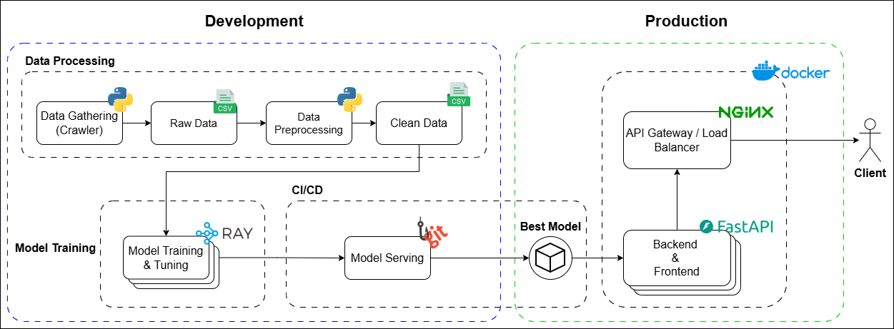
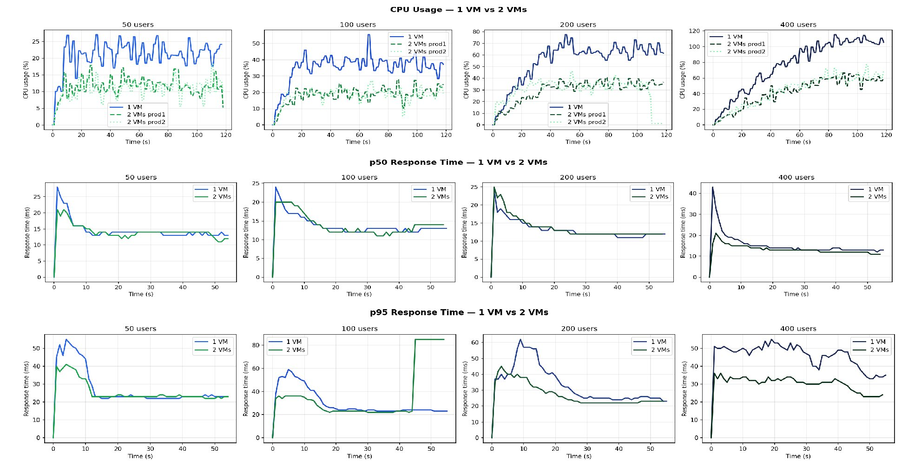

<p align="center">
    <h1 align="center">Github Stars Predictor</h1>
</p>
<p align="center">
    <em>A Scalable Machine Learning System for Predicting Github Repository Popularity</em>
</p>

<details>
  <summary>Table of Contents</summary>

- [Overview](#overview)
- [Repository Structure](#repository-structure)
- [How to Run](#how-to-run)
  - [Prerequisites](#prerequisites)
  - [Deploy](#deploy)
  - [Test](#test)
- [Project Highlights](#project-highlights)
  - [Data Collection and Processing](#data-collection-and-processing)
  - [Results](#results)

</details>
<hr>

## Overview

This project goes beyond building a machine learning model to predict the star count of GitHub repositories — it demonstrates an MLOps ecosystem designed for scalability, automation, and operational reliability.

The system is built around an end-to-end architecture spanning both development and production environments. In the development environment, the pipeline supports data collection, preprocessing, experimentation, and distributed model training. Once trained, models are automatically deployed into production through a CI/CD workflow powered by Git hooks, reducing manual intervention and enabling faster iteration cycles.

On the production side, the system serves predictions through scalable back-end and front-end services deployed behind a load balancer, allowing requests to be efficiently distributed across instances. Distributed training with Ray and prediction services built with FastAPI are architected for horizontal expansion and performance testing under increasing workloads.



- Machine learning model for GitHub repository star prediction
- End-to-end MLOps workflow from training to deployment
- Horizontally scalable training and inference services
- Automated CI/CD for model deployment using Git hooks
- Load-balanced production architecture
- Secure infrastructure with bastion host access control


## Repository Structure

```sh
└── /
    ├── ansible/    # ansible scripts for orchestration
    ├── data/       # raw and clean dataset
    ├── models/     # best ML model (.pkl) and its metadata
    ├── notebooks/  # exploration python notebooks
    ├── script/
    │   ├── install/    # installation scripts
    │   └── ray/        # scripts to test ray cluster
    ├── src
    │   ├── app         # frontend + backend of predictor app
    │   ├── data        # data collector script
    │   ├── features    # pre-processing and feature engineering script
    │   ├── tests       # scalability test scripts (locust)
    │   └── training    # model training script
    └── terraform       # terraform scripts for spawning infrastructure
```

## How to Run

This project is designed to run on a distributed cloud environment (multi VM), in this case OpenStack. A minimum of 3 VMs are required: 1 jump server, 1 development server, and 1 production server.

### Prerequisites

Ansible, Terraform, and OpenStack Client installed on the jump server. Installation scripts are provided at `script/install/`.

### Deploy

1. Spawn infrastructure using Terraform. Read more at [`terraform/`](./terraform/)
2. Contextualize and orchestrate infrastructure using Ansible. Read more at [`ansible/`](./ansible/)
3. The gateway is located at the `prod1` host. Get its public IP and access the predictor app through port `8888`

### Test

To test the predictor app's inference performance and scalability, read more at [`src/tests/`](./src/tests/)


## Project Highlights

### Data Collection and Processing

Data was collected from the GitHub REST API in two phases. First, the top 1,000 public repositories with at least 50 stars were identified. From these, 24 raw features were collected across four categories:

| Category | Collected Features |
|---|---|
| Identifiers & Target | name, full_name, stars |
| Activity Metrics | commits, forks, watchers, open_issues, open_pull_requests, releases, contributors, subscribers_count, network_count |
| Project Metadata | language, size, created_at, updated_at, description, homepage, license, topics |
| Boolean Flags | has_wiki, has_pages, is_fork, archived |

Rate limits were managed dynamically by monitoring the `X-RateLimit-Remaining` and `X-RateLimit-Reset` headers. For aggregate metrics (commits, contributors, releases, open pull requests), each request was issued with `per_page=1` and the total extracted from the HTTP `Link` header, retrieving the exact count in a single API call per metric.

The preprocessing pipeline applied a `log1p` transformation to the star count target to handle the right skew of the data. Several columns were dropped: identifiers with no predictive value, `watchers` (identical to stars, which would cause data leakage), and `is_fork` (all zeros). New features were engineered from the raw fields:

- `repo_age_days` — days between creation and data collection
- `commits_per_day` — total commits divided by age
- `fork_ratio` — forks divided by stars + 1
- `has_description`, `has_homepage`, `has_license` — binary flags from text fields
- Language one-hot encoding — 17 binary columns from 42 unique language values

Missing values were filled with column medians. The final dataset has 1,000 rows and 36 columns.

### Results

#### Machine Learning Model Comparison

Five regression models were trained and evaluated on an 80/20 train-test split. LightGBM, XGBoost, and Random Forest were tuned with Bayesian hyperparameter search using Optuna (50 trials each) distributed across a Ray cluster. Ridge and ElasticNet were trained as linear baselines.

| Model | RMSE | MAE | R² |
|---|---|---|---|
| **LightGBM** (selected) | 0.0699 | 0.0462 | 0.9750 |
| XGBoost | 0.0749 | 0.0539 | 0.9713 |
| Random Forest | 0.1182 | 0.0725 | 0.9285 |
| Ridge | 0.2685 | 0.2099 | 0.6314 |
| ElasticNet | 0.3258 | 0.2569 | 0.4570 |

LightGBM achieved the best performance with R² = 0.975. The large gap between tree-based and linear models confirms the relationship between repository features and popularity is strongly non-linear. A stacking ensemble of all five models achieved R² = 0.9795, but was not selected for deployment due to the added complexity of running five models per prediction request.

#### Scalability of Model Training

The full tuning pipeline was run on 1, 2, and 3 Ray nodes (2 CPUs, 2.44 GB RAM each), averaged over 3 runs:

| Nodes | Total CPUs | Total Time (s) | Speedup | CPU Utilisation |
|---|---|---|---|---|
| 1 | 2 | 1470 ± 30 | 1.00x | 79.5% |
| 2 | 4 | 915 ± 42 | 1.61x | 65.3% |
| 3 | 6 | 702 ± 12 | 2.09x | 53.3% |

Scaling efficiency was approximately 70% at both 2 and 3 nodes, consistent with Ray scheduling overhead and sequential pipeline components. Peak RAM remained stable at ~3,250–3,430 MB across all configurations.

#### Scalability of the Application

Load tests were run using Locust with 50, 100, 200, and 400 concurrent users against a single VM and two VMs behind NGINX. Each test ran for 60 seconds, spawning 10 users per second.



The p50 response time was roughly equal for 1 and 2 VMs across all user counts (~12–13 ms). The p95 response time showed clearer differences at higher load — at 200 and 400 users, two VMs had lower p95 values (22 ms, 29 ms) compared to one VM (25 ms, 45 ms). CPU usage differences increased with load: 12%, 15%, 30%, and 50% lower on two VMs for 50, 100, 200, and 400 users respectively. For 400 or more concurrent users, two VMs are recommended both for performance and fault tolerance.


## Acknowledgments

### Contributors:
