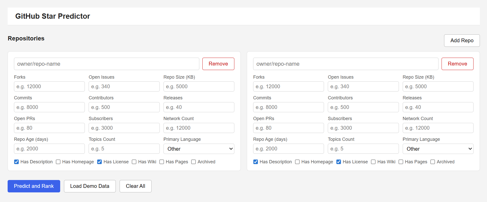
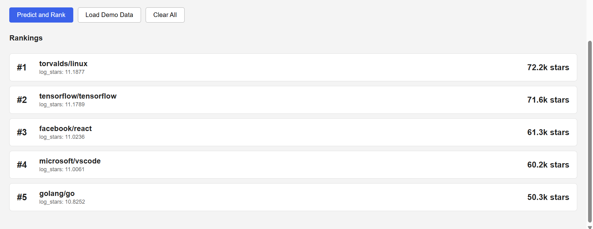

# Application

The application is deployed on the following URL: http://130.238.27.176:8888/. If the VMs are re-initialised then the application will run on URL: http://<prod1_floating_point_IP>:8888/

## How It Works

### 1. Add repositories and enter features

Add one or more GitHub repositories using the Add Repo. For each repository, fill in the relevant features: numeric values like `repo_age_days`, `commits_per_day`, `fork_ratio`, and `topics_count`; boolean toggles for `has_description`, `has_homepage`, `has_license`, `has_wiki`, `has_pages`, and `archived`; and a language selector.

### 2. Predict and rank

Click the **Predict and rank** button. The app runs the ML model against all loaded repositories and displays them ranked from highest to lowest predicted star count.

### 3. Health endpoint

When going to the `/health` endpoint of the website, it gives an overview of the container status, whether the model is loaded and the exact model used, and the Docker container the website is running on.
